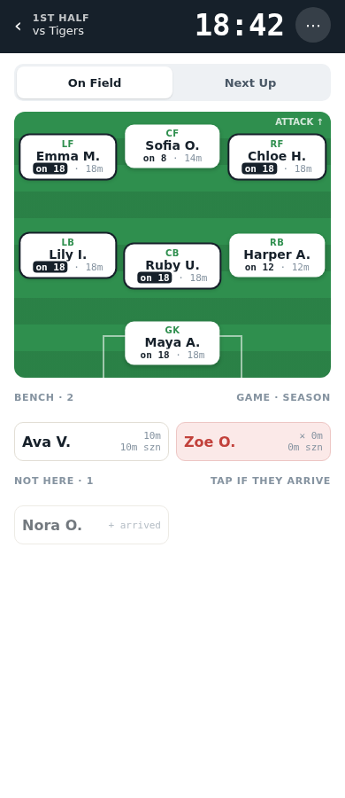

# Soccer Coach

Soccer Coach helps youth soccer coaches track lineups, playing time and positions.
Build the next lineup during play, record the sub at the stoppage,
and see at a glance who needs more minutes or hasn't tried a position yet.



App: https://dougflip.github.io/soccer-coach

## Docs

- [High-level design](./high-level-design.md): goals and key decisions
- [UX design](./design-doc.html): screens, flows and mockups
- [Architecture](./arch-doc.md): data model, sync, phasing

## Local Development

```sh
# switch to proper node
nvm use

# install deps
npm i

# run the dev server (add `-- --host` to open it on your phone)
npm run dev

# run static analysis checks against the code
npm run check

# format the code
npm run format
```

## Tests

Unit tests run via Vitest:

```sh
npm test
```

## Stack

React + TypeScript + [Vite](https://vite.dev/) as a PWA,
[Dexie](https://dexie.org/) (IndexedDB) for offline-first storage
and [Supabase](https://supabase.com/) for auth and sync.
