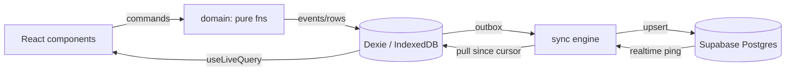

# Soccer Coach: Architecture

Status: **v0.2** (2026-10-06). Inputs: `high-level-design.md`, `design-doc.html` (UX),
`src/domain/` (spike). Hygiene rules live in `CLAUDE.md`; this doc covers structure and decisions.

## 1. Constraints

1. Static PWA on GitHub Pages. No servers we host.
2. Offline-first: fields have poor signal. Recording must never wait on the network.
3. 2 coaches, 1 team, ~12 players, ~15 games/season. Tiny data; optimize for simplicity, not scale.
4. Shared data between coaches, eventually consistent within seconds when online (basic in Phase 1, realtime later; see §13).
5. Don't box ourselves out of multiple teams/seasons, but don't build UI for them.

## 2. Stack

| Concern    | Choice                                                     |
| ---------- | ---------------------------------------------------------- |
| Build      | Vite 8, TS 7 (strict), React 19 + React Compiler           |
| Routing    | TanStack Router, hash history                              |
| Local DB   | Dexie 4 (IndexedDB) + `dexie-react-hooks` (`useLiveQuery`) |
| Backend    | Supabase: Postgres, Auth, Row Level Security, Realtime     |
| Validation | zod 4 at every boundary (Supabase, IndexedDB, URL params)  |
| PWA        | `vite-plugin-pwa` (generateSW)                             |
| Styling    | CSS Modules + `src/tokens.css` custom properties           |
| Quality    | oxlint (type-aware), oxfmt, Vitest, CI on GitHub Actions   |

Not used: TanStack Query (local DB is the source of truth, not a server cache), Redux/Zustand.

## 3. High-level data flow



1. UI never talks to Supabase directly (except auth). It reads and writes Dexie only.
2. Every local write is a single Dexie transaction: write the row/event **and** an outbox entry.
3. The sync engine pushes the outbox and pulls remote changes into Dexie. Realtime is only a
   "something changed, pull now" signal; we never apply realtime payloads directly.

## 4. Data model

Two kinds of data:

1. **Game events**: append-only, immutable, event-sourced (see `src/domain/events.ts`). Merge
   between devices is trivial: union by `id`.
2. **Reference rows** (team, players, games metadata): small, rarely edited, mutable.
   Last-write-wins per row using a server-set `updated_at`. Concurrent edits to the same
   player by both coaches are rare enough that LWW is fine.

### Postgres tables

```sql
teams         (id uuid pk, name text, created_at timestamptz)
team_members  (team_id uuid fk, user_id uuid fk auth.users, role text, pk(team_id, user_id))
players       (id uuid pk, team_id uuid fk, first_name text, last_initials text,
               archived_at timestamptz null, updated_at timestamptz, deleted boolean)
games         (id uuid pk, team_id uuid fk, opponent text, starts_at timestamptz,
               location text null, updated_at timestamptz, deleted boolean)
game_events   (id uuid pk, team_id uuid fk, game_id uuid fk, type text, payload jsonb,
               created_at bigint,        -- client-recorded (server-corrected) epoch ms
               created_by uuid,          -- auth.uid(), set by default
               inserted_at timestamptz default now())  -- server, used as sync cursor
```

1. IDs are UUIDs generated on the client (`crypto.randomUUID()`), so offline creates need no
   server round trip and pushes are idempotent.
2. `team_id` is denormalized onto `game_events` so every RLS policy is the same one-liner.
3. Event payload is stored as `jsonb` and validated by `GameEventSchema` when read. The DB
   doesn't need to understand event types. New event types need no migration.
4. Soft delete (`deleted`) instead of `DELETE` so deletions sync like any other update.
   (Players use `archived_at` to leave the roster but keep stats; `deleted` is only for
   mistakes with no game history.)
5. `updated_at` is set by a trigger (`now()`), never by the client, so device clocks can't
   break LWW or cursors.

### Dexie tables (local)

Mirror of the above (`players`, `games`, `gameEvents`) plus local-only:

| Table       | Purpose                                                                        |
| ----------- | ------------------------------------------------------------------------------ |
| `outbox`    | Pending pushes: `{ seq, table, rowId }` (the current row is read at push time) |
| `syncState` | Pull cursors per table, server clock offset, last sync time                    |
| `drafts`    | Per-coach Next Up draft per game. Never synced (UX decision).                  |

All reads from Dexie go through zod parse in the repository layer, so a schema change
surfaces as a parse error, not a silent `undefined`.

## 5. Domain layer (done in spike)

`src/domain/` is pure TS, no imports from React/Dexie/Supabase. Summary:

| Module                    | Role                                                                            |
| ------------------------- | ------------------------------------------------------------------------------- |
| `events.ts`               | Event union (zod). Game-clock `at` for stats; `wallTime` only for clock control |
| `log.ts`                  | `effectiveEvents` (voids, incl. void-of-void), deterministic ordering           |
| `clock.ts`                | Live clock from timestamps (start/pause/resume/adjust)                          |
| `status.ts`               | pregame / live / break / final, `currentGameTime`                               |
| `sweep.ts`, `segments.ts` | Per-player time buckets: field(position), bench available/unavailable           |
| `stints.ts`               | Current stint, longest-stint highlight                                          |
| `stats.ts`                | Per game, season totals, `availableShare` (default fairness metric)             |
| `issues.ts`               | Inconsistencies to flag after edits                                             |
| `commands.ts`             | UI action -> events, incl. edit (= void + replacement)                          |

Rules:

1. Projections are lenient: bad data produces `issues`, never throws.
2. Everything is recomputed from events on render. A game has ~100 events, a season ~1.5k;
   no caching or snapshots needed. Revisit only if profiling says so.

## 6. Sync engine

Lives in `src/data/sync/`. One instance, started after login.

### Push

1. Triggers: after any local write (debounced ~500ms), `online` event, app becomes visible,
   every 30s while visible.
2. Drain outbox in `seq` order, batched per table:
   1. `game_events`: `insert ... on conflict (id) do nothing` (immutable, idempotent).
   2. Reference rows: `upsert` (LWW).
3. Delete outbox entries only after the server confirms. Failures back off (1s, 2s, 4s… cap 60s).
4. A push that fails validation (RLS denial, bad data) is parked and surfaced in the sync
   indicator rather than retried forever.

### Pull

1. Triggers: app open, app visible, after push, every 60s while visible, manual refresh (realtime notification later).
2. Per table: `select * where team_id = ? and <cursor column> > (cursor - 30s overlap)`.
   1. Cursor column: `inserted_at` for events, `updated_at` for rows.
   2. The overlap re-reads recent rows so a transaction that committed late (with an earlier
      timestamp) isn't missed. Re-reading is harmless: events dedupe by `id`, rows by LWW.
3. Write into Dexie in one transaction, then advance the cursor. `useLiveQuery` re-renders.

### Realtime (Phase 2)

Subscribe to `postgres_changes` on the three tables filtered by `team_id`. On any message,
schedule a pull. Realtime drops while backgrounded/offline; the visibility/online pulls cover that.

### Clock skew between devices (Phase 2)

The live clock uses the `wallTime` from whichever phone started the period; another phone
computes elapsed time with its own clock. Fix: on each sync, estimate
`serverOffset = serverNow - localNow` (from a cheap `select now()` RPC, halving round-trip),
store it in `syncState`, and stamp all `wallTime`/`createdAt` with `Date.now() + serverOffset`
via the injected `CommandContext.now`. Both phones then agree within a few hundred ms.
Before the first successful sync, offset is 0.

### Sync status UI

Expose `{ state: "synced" | "pending" | "offline" | "error", pendingCount }` from the engine for
the small indicator in the clock bar (UX §13).

## 7. Auth & access

1. **Email + password** (`signInWithPassword`). Coach accounts are created in the Supabase
   dashboard with a generated password (saved in each coach's password manager); sign-ups
   are disabled.
   1. Why not email codes / magic links: Supabase's built-in email can't use edited templates
      and only delivers to org members, so any email login needs custom SMTP. Not worth it for
      2 users; revisit (e.g. Resend) if needed.
2. Session persists in local storage; refresh tokens keep coaches logged in for the season.
3. Supabase project uses the new publishable key in the client (public by design; RLS is the
   security boundary).
4. RLS on every table:

   ```sql
   create function is_team_member(t uuid) returns boolean
     language sql security definer stable as $$
       select exists (select 1 from team_members where team_id = t and user_id = auth.uid())
     $$;
   -- per table: using (is_team_member(team_id)) with check (is_team_member(team_id))
   -- game_events: insert + select only (no update/delete policies => immutable)
   ```

5. Team setup for MVP: create the coach in the dashboard (with password), then a SQL seed
   adds them to `team_members` (done via MCP for team "Galaxy"). No invite UI yet.
6. Sign-ups are disabled in Supabase; non-members would see nothing anyway (RLS).

## 8. Client structure

```
src/
  domain/        pure logic (spike)
  data/
    db.ts        Dexie schema + versions
    schemas.ts   zod for rows (events reuse domain schema)
    repos/       typed read/write functions (players, games, events); write = row + outbox
    sync/        push, pull, realtime, clock offset, status
    supabase.ts  client + generated database.types.ts
  app/           router, providers (auth, team), layout, tab bar
  features/
    roster/  games/  pregame/  live-game/  review/  stats/
  ui/            shared primitives (Button, Sheet, Toast, FieldView, PlayerChip, Segmented)
  tokens.css
```

### Reading data in components

```ts
const events = useLiveQuery(() => repos.events.forGame(gameId), [gameId]) ?? [];
const effective = effectiveEvents(events);
const now = useNow(1000); // re-render each second, live screen only
const at = currentGameTime(effective, now);
const segments = buildSegments(effective, at ?? undefined);
```

No memoization by hand (React Compiler). If season stats ever get slow, compute per-game
stats once per game change and cache in memory by `(gameId, eventCount)`.

### Writing

```ts
const ctx = useCommandContext(gameId); // newId = randomUUID, now = Date.now + serverOffset
await repos.events.append(subOffUnavailable(ctx, { at, lineup, playerId, replacement }));
```

### Routes

Hash history (`/#/…`): works on GitHub Pages without a 404 workaround and offline.

```
/games                     list
/games/$gameId             view chosen by status: pregame | live | break | review
/games/$gameId/timeline    edit shifts
/roster   /roster/$playerId
/stats    /stats/players/$playerId   ?scope=season|<gameId>
/login
```

Route params parse through zod to branded IDs (`GameIdSchema`) in the route definition.

## 9. Browser APIs

1. **Wake lock**: request while a period is live; re-acquire on `visibilitychange` (the
   browser drops it when hidden). Release at break/final.
2. **Dim mode**: CSS class on `<html>` toggling a fixed black overlay + inactivity timer.
   First tap is swallowed.
3. **Storage persistence**: call `navigator.storage.persist()` after login so the browser
   doesn't evict IndexedDB (and unsynced outbox) under pressure. Installed PWAs on iOS are
   exempt from Safari's 7-day eviction; prompting install is part of onboarding.

## 10. PWA

1. `vite-plugin-pwa`, `generateSW`, precache the app shell. With hash routing there's a single
   `index.html`, so no navigation fallback rules.
2. Update flow: `registerType: "prompt"`. Show "Update available" toast; never auto-reload
   during a live game.
3. Manifest: standalone, portrait, theme color from tokens. Icons via `@vite-pwa/assets-generator`.

## 11. Environments & deploy

1. **Supabase**: one hosted project for prod. Schema as SQL migrations in
   `supabase/migrations/`, applied with the Supabase CLI (`supabase db push`), manual for MVP.
2. **Types**: `supabase gen types typescript` -> `src/data/database.types.ts`, committed.
3. **Local dev**: see open question 2.
4. **Frontend**: GitHub Actions builds on `main` and deploys with
   `actions/upload-pages-artifact` + `actions/deploy-pages`. `VITE_SUPABASE_URL` and
   `VITE_SUPABASE_PUBLISHABLE_KEY` come from repo variables (public values).
5. Supabase free tier pauses after 7 days idle; un-pause from the dashboard in the offseason.

## 12. Testing

1. **Domain**: exhaustive unit tests (current: 19). Every bug becomes a test here first.
2. **Data/sync**: Vitest + `fake-indexeddb` for repos and outbox; Supabase calls behind a small
   interface so push/pull logic is tested with a fake server (ordering, retries, overlap
   dedupe, offline -> online).
3. **Components**: Testing Library for the interaction-heavy pieces only (tap-tap lineup
   editing, Next Up diff, player sheet).
4. **E2E**: a couple of Playwright smoke tests later (record a game offline, go online, see it
   on a second browser context).

## 13. Phasing & milestones

Reality check: ~4-5 games left this season and one primary user (the other coach watches the
game). So Phase 1 keeps the backend but makes sync **basic**: push an outbox, pull on a few
triggers, last-write-wins. Fancy parts wait.

| Sync piece                                                                         | Phase 1 | Later                                                 |
| ---------------------------------------------------------------------------------- | ------- | ----------------------------------------------------- |
| Supabase, login, RLS                                                               | ✅      |                                                       |
| Outbox push (events idempotent, rows LWW)                                          | ✅      |                                                       |
| Pull on app open, app visible, after push, every 60s while visible, manual refresh | ✅      |                                                       |
| Basic status ("n unsynced" / "offline")                                            | ✅      |                                                       |
| Realtime subscription                                                              |         | ✅ (60s poll is enough for now)                       |
| Clock-skew offset (§6)                                                             |         | ✅ (only matters if both phones watch the live clock) |

### Phase 1: this season

| #   | Scope                                                                                                                                                                                          | Done when                                                                                 |
| --- | ---------------------------------------------------------------------------------------------------------------------------------------------------------------------------------------------- | ----------------------------------------------------------------------------------------- |
| M0  | Scaffold + domain spike                                                                                                                                                                        | ✅                                                                                        |
| M1  | Supabase schema + RLS + seed, email/password login, Dexie + repos + basic sync, Roster CRUD, Games list + new game, Pages deploy, installable PWA (basic manifest + precache)                  | Roster and games saved to Supabase from my phone, visible on a second phone after refresh |
| M2  | Pre-game (attendance, starting lineup), Live game (clock, On Field, Next Up, Sub now + undo, player sheet incl. injury sub-off, available toggle, late arrival, halftime, end game), wake lock | Can run a real game                                                                       |
| M3  | Game minutes table + season team grid (same component), simple timeline: list events, delete (void), edit time                                                                                 | See fairness, fix obvious mistakes                                                        |

Phase 1 cuts: realtime, clock-skew offset, player detail screen, lineup editing in the
timeline (void + re-record instead), dim mode, update prompt (new version activates on next
launch), JSON export.

### Phase 2: offseason

| #    | Scope                                                       |
| ---- | ----------------------------------------------------------- |
| P2.1 | Realtime, clock-skew offset, richer sync status             |
| P2.2 | Player detail, full timeline editing (lineups, insert)      |
| P2.3 | Dim mode, update prompt, JSON/CSV export, offline hardening |

## 14. Risks

1. **Hand-rolled sync bugs.** Mitigated by immutable events, idempotent pushes and heavy tests.
   Pivot plan: PowerSync (same Postgres schema works).
2. **iOS PWA quirks** (storage, wake lock support, background suspension). Test on a real
   iPhone early in M1.
3. **Data loss before first sync** if a phone dies mid-game. Accept for MVP; the second coach's
   phone usually has synced copies.

## 15. Decisions log

1. Login: email + password (no SMTP needed). Once per device: Supabase refresh tokens don't
   expire by default, so coaches stay signed in until they sign out, clear site data or switch phones.
2. Local dev: Supabase CLI local stack (Docker) for dev/migrations, one hosted
   project for prod. Supabase MCP for inspecting/querying.
3. Repo is public. Nothing secret ships (publishable key is public by design). Seed script
   with coach emails/IDs stays out of git (`supabase/seed.local.sql`, gitignored). Player
   names live only in the DB/IndexedDB, never in the repo.
4. Team/coach setup via SQL seed; no invite UI.
5. Players/games are LWW mutable rows; only game play is event-sourced.
6. Phase 1 includes Supabase + basic sync (outbox push, polled pull, LWW). Realtime and clock-skew correction come later.
